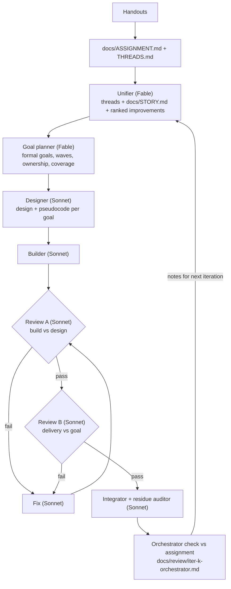

# The study loop

A reusable multi-agent pipeline that turns test handouts into an interactive study map, then
improves it over several iterations. It was used to build this repo (7 iterations).

## Pieces

| Piece | File | Notes |
|---|---|---|
| Assignment | `docs/ASSIGNMENT.md` | The student's words, review problems with ids, topics, definitions, story seed. Everything is checked against it. |
| Candidate threads | `docs/THREADS.md` | Ideas the Unifier tests against every problem. |
| Engineering + design contract | `docs/CONSTRAINTS.md` | Stack, routing, theming, file ownership, verification commands, media track. |
| Goal schema | `docs/goal-schema.json` | id, wave, depends_on, kind, story_thread, assignment_refs, owns, reads, interfaces, deliverable, acceptance (each with a verification method), out_of_scope, size. |
| Workflow | `.claude/workflows/study-build-loop.js` | `mode: plan` (Unifier + planner), `mode: execute` (design, build, review A, review B, up to 3 fix rounds per goal), `mode: integrate` (integrator + auditor until no residue). |
| Orchestration | `.claude/skills/study-session/SKILL.md` | Runs the modes in order, parallelises execute runs, does the assignment check between iterations. |
| Smoke harness | `tools/smoke.mjs` | Headless Chromium over every route, desktop + phone (+ dark), interaction scripts, screenshots. |
| Video + audio | `tools/videos/render.mjs`, `tools/media/generate-audio.mjs`, `videos/lib/narrated.py` | manim scenes timed to narration; audio generated locally under Doppler. |

## Why it is shaped this way

- **Verifiable goals.** Review B executes the planner's acceptance criteria literally, so every
  criterion names a method: unit test with exact values, smoke route, interaction script,
  a specific screenshot claim, or a code property.
- **Two reviews.** Review A catches "built something different from the design"; Review B
  catches "built the design, but the design missed the goal". Either failing sends the work back
  to a fix round.
- **Exclusive file ownership per wave** lets builders work in parallel in one checkout without
  worktrees. The planner's waves are re-checked in code; clashing goals are pushed to a later wave.
- **No residue.** Unresolved review findings and cross-owner requests flow into integration;
  the auditor must verify the list is empty before the orchestrator's check.
- **The orchestrator checks against the assignment, not the goals.** Goals can all pass while
  the student's actual need is unmet; the between-iteration review is where that gets caught,
  and its notes steer the next Unifier pass.

## Starting a new study session

1. Copy this repo (or use it as a GitHub template). Delete the site content (`index.html`,
   `css/`, `js/`, `tests/unit/*`, `tests/interact/*`, `docs/goals/*`, `docs/designs/*`,
   `docs/review/*`, `docs/STORY.md`, `docs/ARCHITECTURE.md`, `videos/scenes/*`, `media/*`), keep
   the tooling.
2. Open Claude Code in it, attach the handouts, and run `/study-session` (optionally "with 3
   iterations").
3. When it finishes, view it locally as described in the README.
